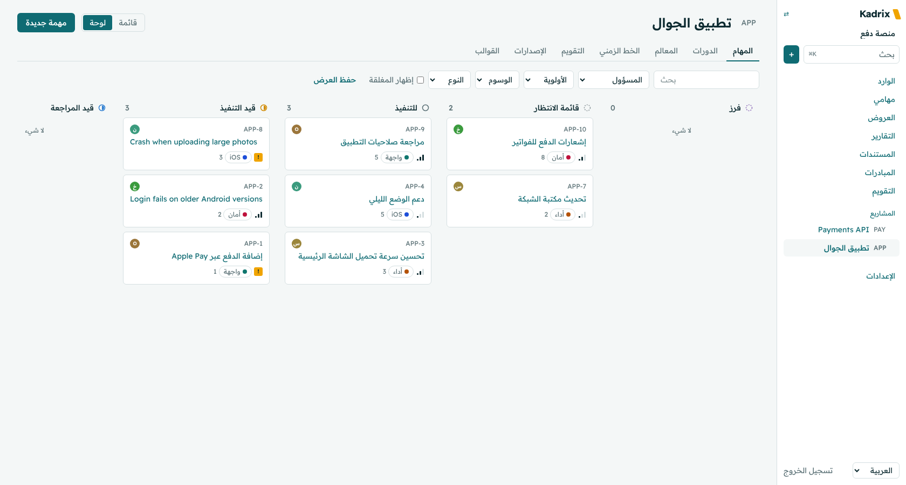
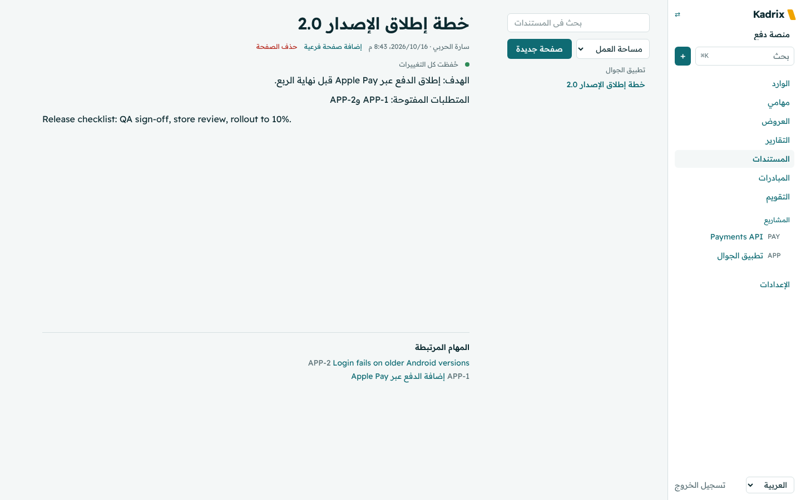
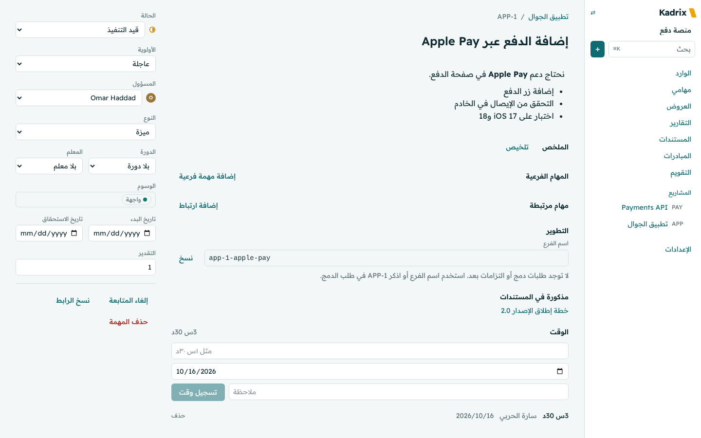

<div dir="rtl">

<p align="center">
  
</p>

<h1 align="center">Kadrix</h1>

<p align="center">
  أداة مفتوحة المصدر لإدارة مشاريع الفرق التقنية.<br>
  العربية والإنجليزية بمستوى واحد، وتعمل على خادمك الخاص.
</p>

<p align="center">
  <a href="README.md">English</a> ·
  <a href="docs/ar/install.md">التثبيت</a> ·
  <a href="docs/ar/configuration.md">الإعدادات</a> ·
  <a href="docs/ar/agents.md">وكلاء الذكاء الاصطناعي</a> ·
  <a href="docs/ar/api.md">الواجهة البرمجية</a>
</p>

<p align="center">
  
</p>

> **الحالة:** لم يُطلق بعد. كل ما هنا يعمل ومختبر، والإصدار العام الأول قيد التجهيز، وقد تتغير أشياء حتى الإصدار 1.0.

## لماذا Kadrix

**لغتان في منتج واحد.** كل شاشة تعمل من اليمين لليسار بالعربية ومن اليسار لليمين بالإنجليزية، ولا تُعامل إحداهما كترجمة للأخرى. النص المختلط يحتفظ باتجاهه، والبحث العربي يتجاهل اختلاف الإملاء ("إدارة" تجد "ادارة" و"مشروع" تجد "المشروع")، والوقت يُكتب مثل ١س ٣٠د، وأيام العمل تتبع منطقتك.

**ملكك أنت.** حاوية تطبيق واحدة مع PostgreSQL، بلا محرك بحث منفصل ولا طوابير ولا خدمة لحظية مستقلة. الفرق الصغيرة تشغله على خادم بذاكرة 1 جيجابايت.

**مصمم للعمل البرمجي.** مهام بأرقام مثل `WEB-12`، ولوحات، ودورات مع مخطط الإنجاز، ومعالم، وخطط زمنية بالاعتماديات، وإصدارات بسجل تغييرات، وربط مع GitHub وGitLab ينقل المهام تلقائيًا مع فتح طلبات الدمج ودمجها.

**مفتوح لوكلاء الذكاء الاصطناعي بلا مفاجآت.** خادم MCP مدمج يتيح لـ Claude Code وCursor وغيرها العمل على المهام بأسمائها وصلاحياتها. وميزات الذكاء الاصطناعي متوقفة حتى تختار مزودًا، ولو كان نموذجًا محليًا.

## الميزات

| | |
|---|---|
| **العمل** | مهام ومهام فرعية وارتباطات ووسوم وأولويات وتقديرات وحقول مخصصة وقوالب ومهام متكررة وتعديل جماعي وعروض محفوظة وقائمة ولوحة بحدود للعمل الجاري |
| **التخطيط** | دورات مع ترحيل وسرعة فريق، ومخطط الإنجاز، ومعالم، ومبادرات بتحديثات الحالة، وخط زمني بالمسار الحرج، وتقويم |
| **المستندات** | صفحات لكل مشروع بتحرير مشترك مباشر، واتجاه لكل فقرة، وأرقام مهام ترتبط بالاتجاهين |
| **للمطورين** | ربط GitHub وGitLab بكلمات إغلاق عربية وإنجليزية، ورموز وصول، ووصف OpenAPI، وخطافات موقعة (JSON وSlack وDiscord)، وإصدارات |
| **المؤشرات** | زمن التسليم وزمن الدورة والإنتاجية والتدفق التراكمي وتوزيع العمل وتسجيل الوقت |
| **الأتمتة** | قواعد على ستة أحداث بشروط وسبعة إجراءات، بحدود آمنة |
| **الانتقال** | استيراد من Jira وLinear وGitHub وأي ملف CSV، وإعادته آمنة |
| **الأشخاص** | مالكون ومشرفون وأعضاء وضيوف محصورون في مشاريع محددة ووكلاء ذكاء اصطناعي، وصندوق وارد وإشارات وملخص بريدي يومي |
| **الأمان** | تحقق بخطوتين، وقواعد كلمات مرور وفق معيار NIST، وحدود للطلبات، وسجل تدقيق لا يُعدَّل، وخطافات محمية، وأسرار مشفرة |
| **في كل مكان** | تطبيق قابل للتثبيت يفتح بدون إنترنت، ويعمل على الجوال، مع اختصارات لوحة المفاتيح وقائمة الأوامر |

<p align="center">
  
  
</p>

## البدء السريع

</div>

```bash
git clone https://github.com/alqadi1423-sketch/veloq.git
cd kadrix
cp .env.example .env    # اضبط AUTH_SECRET وPOSTGRES_PASSWORD
docker compose up -d
```

<div dir="rtl">

افتح http://localhost:3000 وأنشئ حسابًا. للخادم الحقيقي أو HTTPS أو التثبيت بدون Docker راجع [دليل التثبيت](docs/ar/install.md).

## المساهمة

المساهمات بالعربية أو الإنجليزية مرحب بها. راجع [CONTRIBUTING.md](CONTRIBUTING.md)، وسيُطلب منك مرة واحدة الموافقة على [اتفاقية المساهمين](CLA.md). ولمشكلات الأمان اتبع [SECURITY.md](SECURITY.md).

## الرخصة

[GNU AGPL الإصدار 3.0 أو أحدث](LICENSE). لك استخدام Kadrix وتعديله واستضافته بحرية، وإن قدّمت نسخة معدلة للآخرين عبر الشبكة فشارك تعديلاتك بالرخصة نفسها. الاسم والشعار تحكمهما [سياسة العلامة التجارية](TRADEMARKS.md).

</div>
